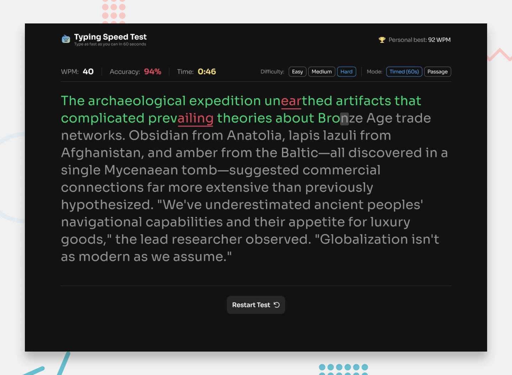

# Frontend Mentor — Тест скорости печати



## Добро пожаловать! 👋

Спасибо, что выбрали это задание по фронтенд-разработке!

Задания [Frontend Mentor](https://www.frontendmentor.io) помогают развивать навыки программирования, создавая проекты, приближённые к реальным задачам.

**Для выполнения этого задания необходимо хорошо разбираться в HTML, CSS и JavaScript.**

## Задача

Ваша задача — разработать приложение для проверки скорости печати, максимально точно повторив представленный дизайн.

Вы можете использовать любые инструменты, которые помогут вам выполнить задание. Если хотите попрактиковаться с какой-либо технологией, можете смело применять её.

Данные с текстами для печати хранятся в локальном файле `data.json`. Вы можете использовать его, чтобы случайным образом выбирать тексты разной сложности.

Пользователи должны иметь возможность:

### Управление тестом

- Начинать тест нажатием на кнопку запуска или нажатием на текст с последующим вводом символов.
- Выбирать уровень сложности (Easy, Medium, Hard), соответствующий разной сложности текстов.
- Переключаться между режимами «Timed (60s)» и «Passage» (в первом режиме таймер отсчитывает время назад, во втором — вперёд без ограничений).
- Перезапускать тест в любой момент, получая новый случайный текст выбранного уровня сложности.

### Процесс печати

- Видеть статистику WPM, Accuracy и Time в реальном времени.
- Получать визуальную обратную связь: правильно введённые символы выделяются зелёным цветом, ошибки — красным цветом с подчёркиванием, также отображается положение курсора.
- Исправлять ошибки с помощью Backspace (при этом первоначально допущенные ошибки продолжают учитываться при расчёте точности).

### Результаты и прогресс

- Видеть результаты после завершения теста: WPM, Accuracy и количество символов (правильных и неправильных).
- Видеть сообщение «Baseline Established!» после первого завершённого теста, устанавливающее первоначальный личный рекорд.
- Получать праздничное сообщение «High Score Smashed!» с анимацией конфетти при улучшении личного рекорда.
- Сохранять личный рекорд между сеансами с помощью `localStorage`.

### Интерфейс и адаптивность

- Видеть оптимальное расположение элементов интерфейса в зависимости от размера экрана устройства.
- Видеть состояния наведения курсора (`hover`) и фокуса (`focus`) для всех интерактивных элементов.

## Модель данных

В проекте предоставлен файл `data.json` с текстами, сгруппированными по уровням сложности. Каждый текст имеет следующую структуру:

```json
{
  "id": "easy-1",
  "text": "The sun rose over the quiet town. Birds sang in the trees as people woke up and started their day."
}
```

| Свойство | Тип | Описание |
|---|---|---|
| `id` | string | Уникальный идентификатор текста (например, "easy-1", "medium-3", "hard-10") |
| `text` | string | Текст, который пользователь должен напечатать |

## Ожидаемое поведение

- **Запуск теста:** таймер начинает отсчёт, когда пользователь начинает печатать или нажимает кнопку запуска. Нажатие непосредственно на текст и ввод символов также запускают тест.
- **Режим Timed:** обратный отсчёт в течение 60 секунд. Тест завершается, когда таймер достигает нуля или пользователь заканчивает печатать текст.
- **Режим Passage:** таймер отсчитывает время вперёд без ограничений. Тест завершается после ввода всего текста.
- **Обработка ошибок:** неправильные символы выделяются красным цветом и подчёркиваются. Backspace позволяет исправлять ошибки, но они продолжают учитываться при расчёте точности.
- **Логика результатов:**
  - Первый завершённый тест: «Baseline Established!» — устанавливает первоначальный личный рекорд.
  - Новый личный рекорд: «High Score Smashed!» с анимацией конфетти.
  - Обычное завершение: «Test Complete!» с мотивирующим сообщением.

## Сохранение данных

Личный рекорд должен сохраняться между сеансами браузера с помощью `localStorage`. Когда пользователь побивает свой рекорд, новое значение должно сохраняться и отображаться при последующих посещениях сайта.

## Нужна помощь с заданием?

[Присоединяйтесь к нашему сообществу](https://www.frontendmentor.io/community) и задавайте вопросы в канале **#help**.

## Где найти необходимые материалы

Ваша задача — реализовать проект в соответствии с дизайнами, расположенными в папке `/design`. Там находятся версии дизайна для мобильных устройств и настольных компьютеров.

Дизайны представлены в статическом формате JPG. Поскольку это изображения, при определении таких параметров, как `font-size`, `padding` и `margin`, вам придётся самостоятельно оценивать необходимые значения.

Если вы хотите получить файл дизайна Figma, чтобы попрактиковаться в использовании профессиональных инструментов и научиться быстрее создавать более точные макеты, можете [оформить подписку PRO](https://www.frontendmentor.io/pro).

Все необходимые ресурсы для проекта находятся в папке `/assets`. Изображения уже экспортированы в подходящих размерах и оптимизированы.

Также в проект включены variable и static версии файлов необходимых шрифтов. Вы можете подключить шрифты через Google Fonts или использовать локальные файлы, размещая их непосредственно в проекте. Обратите внимание: статические файлы с начертаниями, которые не нужны для этого проекта, были удалены.

Кроме того, в проекте есть файл `style-guide.md`, содержащий необходимую информацию, включая цветовую палитру и используемые шрифты.

## Использование ИИ-помощников для написания кода

Мы добавили два файла, которые помогут вам при использовании ИИ-помощников для программирования (например, Claude, GitHub Copilot, Cursor и других):

- `AGENTS.md` — содержит подробные инструкции для ИИ-помощников о том, как помогать вам при выполнении этого задания. Инструкции адаптированы под уровень сложности проекта, поэтому ИИ будет подбирать подходящий уровень помощи: больше поддержки для начинающих заданий и больше самостоятельности для продвинутых.
- `CLAUDE.md` — файл-указатель, который направляет инструменты на основе Claude к инструкциям из `AGENTS.md`.

### Как ими пользоваться?

Ничего делать не нужно! Большинство ИИ-инструментов для программирования автоматически обнаруживают эти файлы. ИИ прочитает их и скорректирует своё поведение, чтобы стать более подходящим помощником в обучении: будет направлять вас к решениям, а не просто выдавать готовые ответы.

**Важно:** эти файлы созданы для того, чтобы помочь вам учиться, а не выполнять всю работу за вас. ИИ должен задавать вопросы, давать подсказки и объяснять концепции вместо того, чтобы писать готовые решения целиком.

## Создание проекта

Вы можете использовать любой удобный для вас рабочий процесс. Ниже приведён рекомендуемый порядок действий, но следовать ему необязательно.

1. Создайте публичный репозиторий проекта на [GitHub](https://github.com/). Это упростит обмен кодом с сообществом, если вам понадобится помощь. Если вы не знаете, как это сделать, ознакомьтесь с [руководством Try Git](https://try.github.io/).
2. Настройте публикацию кода вашего репозитория по веб-адресу. Это также пригодится, если во время выполнения задания вам понадобится помощь: вы сможете поделиться ссылкой на проект вместе со ссылкой на репозиторий. Существует несколько способов публикации, некоторые из них перечислены ниже.
3. Изучите дизайны и спланируйте реализацию проекта. Это важный этап: заранее продумайте CSS-классы, которые позволят создавать повторно используемые стили.
4. Прежде чем добавлять стили, создайте HTML-структуру содержимого. Написание HTML в первую очередь поможет сосредоточиться на правильной и логичной структуре страницы.
5. Напишите базовые стили проекта, включая общие параметры текста, например `font-family` и `font-size`.
6. Начните стилизовать страницу сверху вниз. Переходите к следующей секции только после того, как будете довольны результатом работы над текущей областью.

## Публикация проекта

Как уже упоминалось, существует множество способов бесплатно разместить ваш проект в интернете. Мы рекомендуем следующие платформы:

- [GitHub Pages](https://pages.github.com/)
- [Vercel](https://vercel.com/)
- [Netlify](https://www.netlify.com/)

Вы можете разместить сайт на одной из этих платформ или воспользоваться другим надёжным хостингом.

[Подробнее о рекомендуемых и проверенных платформах для размещения проектов](https://www.frontendmentor.io/guides/hosting-your-solution).

## Создание собственного `README.md`

Мы настоятельно рекомендуем заменить исходный `README.md` на собственный. В стартовом коде проекта для этого предусмотрен шаблон `README-template.md`.

Шаблон содержит рекомендации о том, какую информацию следует добавить. Собственный `README` поможет вам рассказать о проекте и проанализировать полученные знания.

Вы можете свободно редактировать шаблон по своему усмотрению.

После добавления всей необходимой информации удалите исходный файл и переименуйте `README-template.md` в `README.md`. Тогда он будет отображаться в вашем репозитории как основной README-файл.

## Отправка решения

Отправьте своё решение на платформу, чтобы другие участники сообщества могли его увидеть.

Ознакомьтесь с нашим [полным руководством по отправке решений](https://www.frontendmentor.io/guides/how-to-submit-solutions), чтобы узнать полезные советы.

Если вы хотите получить обратную связь по своему проекту, обязательно задавайте вопросы при отправке решения. Чем конкретнее и подробнее будут ваши вопросы, тем выше вероятность получить полезные рекомендации.

## Как поделиться своим решением

Есть несколько способов поделиться своим проектом:

1. Опубликуйте страницу своего решения в канале **#finished-projects** нашего [сообщества](https://www.frontendmentor.io/community).
2. Поделитесь проектом в [X (ранее Twitter)](https://x.com/frontendmentor), упомянув **@frontendmentor** и добавив ссылки на репозиторий и опубликованный сайт. Мы будем рады посмотреть, что у вас получилось, и помочь рассказать об этом другим.
3. Поделитесь проектом в [LinkedIn](https://www.linkedin.com/company/frontend-mentor/).
4. Напишите статью о своём опыте создания проекта. Описание рабочего процесса, технических решений и разбор собственного кода — отличный способ закрепить полученные знания. Для публикации статей можно использовать [dev.to](https://dev.to/), [Hashnode](https://hashnode.com/) и [CodeNewbie](https://community.codenewbie.org/).

Мы предоставляем шаблоны, которые помогут поделиться решением после его отправки. Не забывайте редактировать их и добавлять конкретные вопросы, если хотите получить обратную связь.

Чем конкретнее ваши вопросы, тем выше вероятность, что другие участники сообщества смогут дать полезный ответ.

## Есть предложения по улучшению?

Мы всегда рады обратной связи! Мы стремимся постоянно улучшать наши задания и платформу. Если у вас есть предложения или замечания, напишите нам на hi[at]frontendmentor[dot]io.

Это задание полностью бесплатное. Поделитесь им с теми, кому оно будет полезно для практики.

**Удачи в разработке!** 🚀